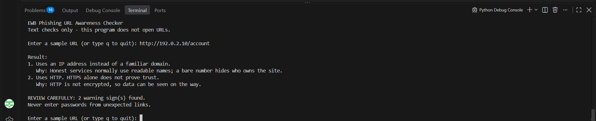
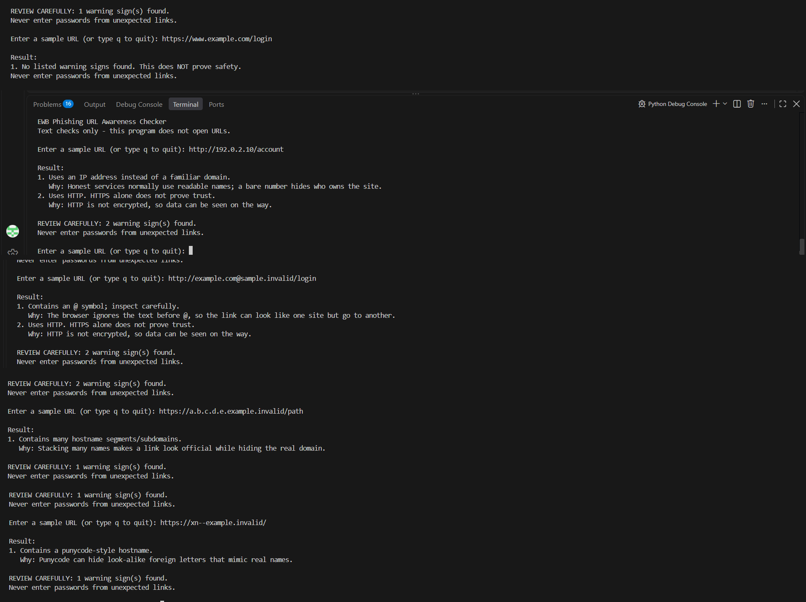

# EWB Phishing URL Awareness Checker

## Overview
Phishing is a trick where a fake link or message tries to make people share passwords, card numbers or OTPs. This command-line tool reads a URL as plain text and points out a few visible warning signs. It never opens the link, so it is safe to use for learning.

## Features
- Detects an @ symbol in the URL
- Flags unusually long URLs (over 100 characters)
- Flags IP-address hostnames
- Flags many hostname segments (5 or more)
- Flags punycode-style hostnames (xn--)
- Flags the HTTP scheme
- Loop mode: check many URLs in one session, type `q` to quit
- "REVIEW CAREFULLY" summary with the number of warnings
- A plain-language reason shown under each warning
- Safe handling of malformed input (no crashes)

## Requirements
Python 3.10 or later. No extra packages.

## How to Run
Windows: `python phishing_checker.py`

Mac/Linux: `python3 phishing_checker.py`

## Example Output
```
EWB Phishing URL Awareness Checker
Text checks only - this program does not open URLs.

Enter a sample URL (or type q to quit): http://192.0.2.10/account

Result:
1. Uses an IP address instead of a familiar domain.
   Why: Honest services normally use readable names; a bare number hides who owns the site.
2. Uses HTTP. HTTPS alone does not prove trust.
   Why: HTTP is not encrypted, so data can be seen on the way.

REVIEW CAREFULLY: 2 warning sign(s) found.
Never enter passwords from unexpected links.
```

## Testing
| # | Input | Expected | Actual | Result |
|---|-------|----------|--------|--------|
| 1 | https://www.example.com/login | No warning signs | No listed warning signs found. This does NOT prove safety. | PASS |
| 2 | http://192.0.2.10/account | IP address + HTTP | IP address warning + HTTP warning | PASS |
| 3 | http://example.com@sample.invalid/login | @ symbol + HTTP | @ symbol warning + HTTP warning | PASS |
| 4 | https://a.b.c.d.e.example.invalid/path | Many hostname segments | Many hostname segments warning | PASS |
| 5 | https://xn--example.invalid/ | Punycode-style hostname | Punycode-style hostname warning | PASS |

The full table with bonus checks is in `tests/test_samples.md`.

## Screenshots



## Improvements
1. **Loop with quit** - The program used to stop after one URL. It now repeats until the user types `q`, `quit` or `exit`, which makes testing faster. I checked it by running several URLs in one session and then quitting.
2. **"Review carefully" summary** - A helper function separates real warnings from information messages, then prints how many warnings were found. This gives a clear final message. I re-ran all five tests to confirm the summary only appears when there are real warnings.
3. **Safe handling of malformed input** - Typing `http://[bad` used to crash with a ValueError. Parsing is now wrapped in try/except, so the program prints a friendly message instead. I tested this with the bad input and re-ran all five tests.
4. **Reasons for each warning** - A dictionary maps each warning to a one-line explanation shown beneath it, so the user learns why it matters. I checked that every warning shows the right reason.

## Limitations
This is an educational tool. It only reads URL text. It does not visit
URLs, scan for malware or prove that a URL is safe. No warning signs
found does NOT mean a URL is safe.

## Ethical Use
Use sample strings only. Do not collect credentials. Do not use this
project to deceive anyone or to test websites without permission.

## Author
Chethan Kumar B, CSE - IoT and Cyber Security including Blockchain Technology, Maharaja Institute of Technology Mysore, EWB Courses
